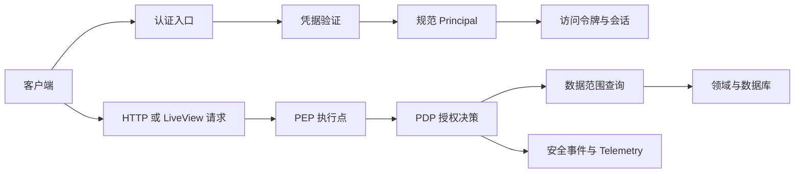

# Keystone Native 与 Keystone Phoenix 鉴权授权统一架构

更新日期：2026-11-14。本文是两个项目的共同架构基线。实现语言、数据库和 Web 框架可以不同，但外部行为、数据约定和安全边界必须一致。项目采用一次性重构，旧设计、旧接口和旧数据结构不进入新系统。

## 术语和命名规则

| 术语 | English | 职责 | 不负责的内容 |
| --- | --- | --- | --- |
| 主体 | Subject | 表示人类用户或服务主体，使用稳定 ID。 | 不表示一次登录，不保存明文凭据。 |
| 凭据 | Credential | 表示密码、刷新令牌、API Key 或外部身份凭据。 | 不直接决定业务权限。 |
| 规范主体 | Principal | 表示当前请求已经验证的主体、凭据类型、会话、权限和认证强度。 | 不负责查询业务记录。 |
| 会话 | Session | 保存一次登录的状态、客户端、令牌族和撤销状态。 | 不替代令牌签名。 |
| 权限 | Permission | 表示稳定的 `resource:action` 动作标识。 | 不表示菜单路径或角色名称。 |
| 数据范围 | Data scope | 限制主体可以访问的租户、部门、所有者或成员关系。 | 不授予动作权限。 |
| 授权决策点 | Policy Decision Point（PDP） | 根据 Principal、Permission、资源和请求上下文返回允许或拒绝。 | 不渲染页面，不直接处理 HTTP。 |
| 授权执行点 | Policy Enforcement Point（PEP） | 在 HTTP、LiveView 或领域命令入口执行 PDP 决策。 | 不复制另一套权限规则。 |
| 安全事件 | Security event | 记录登录、令牌、API Key、MFA 和授权结果。 | 不保存密码、令牌或完整 API Key。 |

新系统只使用两段权限格式：`resource:action`，例如 `user:read`、`user:update`、`api-key:create`、`session:revoke`。三段权限、菜单权限字段和角色名称不属于新接口、数据库或授权输入。权限目录使用固定 UUIDv5，角色只保存权限目录 ID。

## 主键和标识符

用户、角色、部门、岗位、菜单、配置、字典、公告、任务、任务日志、登录日志、操作日志、权限、会话、刷新令牌、刷新令牌事件、服务主体、API Key、MFA 请求和安全事件的逻辑主键统一使用规范小写连字符 UUID。接口和领域层使用字符串；Native 的 MySQL 持久化使用 `BINARY(16)`，Phoenix 的 PostgreSQL 使用原生 `uuid`。新业务实体默认使用 UUIDv7，以便保留创建时间排序特征；权限目录和固定种子使用 UUIDv5，并固定命名空间和名称规则。UUIDv5 不用于随机业务实体。

两个项目都禁止把 UUID 转回整数、使用自增整数或在接口中同时暴露整数和 UUID。Native 的 MySQL 使用 `BINARY(16)` 保存 UUID 原始 16 字节：SQL 写入使用 `UUID_TO_BIN(?, 0)`，文本结果使用 `BIN_TO_UUID(id, 0)`；按 ID 过滤时在参数侧使用 `UUID_TO_BIN(:uuid, 0)`，不在过滤列上调用 `BIN_TO_UUID`，以保持索引可用。ORM 直接把规范字符串转换为同样的 16 字节值，不再叠加 SQL 转换。`0` 保持 UUIDv7 的时间字段顺序，不使用 UUIDv1 专用的字节交换。应用层和 HTTP 接口只接受或返回 36 字符的规范 UUID 字符串。Phoenix 的 PostgreSQL 使用原生 `uuid` 类型。迁移阶段一次性替换旧整数主键、外键、索引、缓存键、日志字段、令牌 Claim 和测试数据。

UUID 生成规则必须集中在基础模块。UUIDv7 生成失败时请求失败，不使用时间戳拼接、随机字符串或整数回退。UUIDv5 固定使用命名空间 `eb754ae2-49de-5e5f-87ef-1fa5eded86d8`，名称使用 UTF-8 小写规范权限前缀 `permission:<resource>:<action>`。例如 `permission:user:read` 的 UUIDv5 是 `950c8856-7230-5a63-937f-472185c3a8c4`。两个项目必须共享该向量和完整权限目录向量。

主键迁移顺序固定为：主体和权限主表、角色与权限关系、部门和组织关系、其他业务主表、刷新令牌和安全事件、外键与联合索引、ORM 实体和仓储、DTO 与路由参数、数据范围和测试夹具。迁移前必须备份并检查整数外键孤儿、`parent_id=0` 哨兵、权限种子和组织祖先字段；迁移后必须检查所有主键/外键类型、索引、UUID 往返和孤儿记录。

## 目标架构



受保护请求必须按相同顺序处理：验证凭据、建立 Principal、检查 Permission、检查 Data scope、执行领域动作、写入安全事件。菜单、按钮和前端状态只影响展示，不承担安全边界。

## Principal 和令牌约定

两个项目的 Principal 至少包含：

```text
subject_id / subject_type
credential_type / credential_id
session_id / client_id
tenant_id / role_ids
permissions / approved_scopes
data_scope / permission_version
authentication_level
```

系统不使用 `is_admin` 字段旁路。管理员能力由系统角色和权限目录授予；角色失效、权限关系删除或数据范围不允许时，即使客户端声明管理员也必须拒绝。

访问令牌必须校验 `iss`、`aud`、`sub`、`jti`、`sid`、`iat`、`exp`、令牌类型、签名算法和 `permission_version`。令牌头部使用 `kid`。访问令牌建议五分钟有效，刷新令牌建议十四天绝对期限和二十四小时非活动期限。刷新令牌每次使用都轮换；旧令牌重用时撤销整个令牌族。签发失败时撤销刚创建或刚轮换的会话。

## 权限、范围和审计

权限目录是唯一权限来源。角色绑定权限 ID，不绑定菜单名称。菜单可以引用权限用于展示，但菜单变化不能改变角色权限。

统一范围策略为 `ALL`、`TENANT`、`SELF`、`DEPARTMENT`、`DEPARTMENT_AND_CHILDREN`、`CUSTOM`、`OWNER` 和 `MEMBER`。列表、详情、更新、删除、导出、批量操作和异步任务都必须使用同一范围策略。批量操作逐个检查目标；任一目标越界时整个事务回滚。

资源适用规则固定如下：用户资源支持 `ALL`、`TENANT`、`SELF`、`DEPARTMENT`、`DEPARTMENT_AND_CHILDREN`、`CUSTOM`；部门资源支持 `ALL`、`TENANT`、`DEPARTMENT`、`DEPARTMENT_AND_CHILDREN`、`CUSTOM`；具有明确所有者或成员关系的资源支持 `ALL`、`OWNER`、`MEMBER`。当前系统为单租户部署，用户和部门资源中的 `TENANT` 等同当前租户的全部数据。没有租户、所有者或成员上下文的资源不得使用对应范围；未登记的范围名称和资源组合默认拒绝。

### Phoenix 资源范围矩阵

Phoenix 的 `RequireResourceScope` 是控制器入口的统一 PEP。它在 `Authenticate` 完成后执行；管理员能力只由 `permission:manage` 授予。用户和部门入口继续使用各自的查询范围过滤，不重复套用本矩阵。其余入口按下表执行，缺少主体、角色范围或关系时返回 `data_scope_denied`：

| 资源标识 | 入口示例 | 支持范围 | 执行规则 |
| --- | --- | --- | --- |
| `user` | `/api/v1/system/users` | `ALL`、`TENANT`、`SELF`、`DEPARTMENT`、`DEPARTMENT_AND_CHILDREN`、`CUSTOM` | 使用现有列表、详情、写入和导出范围检查；先过滤再计数和分页。 |
| `department` | `/api/v1/system/depts` | `ALL`、`TENANT`、`DEPARTMENT`、`DEPARTMENT_AND_CHILDREN`、`CUSTOM` | 使用现有部门层级范围检查；目标部门和子部门关系在写入前核验。 |
| `profile` | `/api/v1/system/user/profile` | `SELF` | 目标固定为当前主体；API Key 主体由人类用户入口拒绝。 |
| `api_key` | `/api/v1/api-keys` | `SELF` | 只能操作当前主体拥有的密钥；签发、列表、轮换和撤销不接受其他主体 ID。 |
| `owned` | 受保护的用户资源文件 | `OWNER`、`MEMBER` | 入口必须提供明确 `owner_id` 或成员列表；当前用户资源文件使用 `OWNER`。 |
| `role`、`post`、`menu`、`config`、`dictionary` | `/api/v1/system/*` | `ALL`、`TENANT` | 资源没有稳定的主体关系；角色数据范围不是 `ALL` 或 `TENANT` 时默认拒绝。 |
| `audit`、`session`、`file` | 日志、监控和通用文件入口 | `ALL`、`TENANT` | 资源没有稳定的所有者或成员关系；只接受全局或当前租户范围。 |
| `job`、`notice` | 任务和公告入口 | `ALL`、`TENANT`、`OWNER` | 公告使用 `owner_id`，任务使用 `created_by`；`OWNER` 主体只能读取和操作自己的记录。 |

`ResourceScope` 只登记可用资源。未知资源和未登记组合默认拒绝。`OWNER`、`MEMBER` 只在入口显式提供关系上下文时生效，不能从请求参数缺失推断为允许。公告和任务必须在查询、详情、更新、删除、执行、日志和导出入口传入 owner 关系；缺少关系时返回 `data_scope_denied` 或空结果，不能退化为全局查询。通用文件入口使用 `ALL/TENANT`；用户资源文件通过 `owned` 规则单独检查。API Key 仍可访问已经批准的业务资源，但不能进入人类认证、密码、MFA 或 API Key 管理路径。

角色、岗位、菜单、配置和字典没有主体关系。它们的创建、更新、删除、状态变更、权限元数据读取和角色用户分配都必须先通过对应资源的 `ALL/TENANT` 范围检查。只有管理页面隐藏或前端权限判断不能替代领域命令的范围检查。

PDP 固定提供：

```text
authorize(principal, permission, resource, context)
allowed(principal, permission, context)
scope_allowed(principal, scope, resource, context)
```

缺少权限映射、主体无效、资源上下文不完整或策略存储不可用时默认拒绝。策略缓存键至少包含版本、租户、主体 ID、凭据 ID、主体角色、批准范围摘要、数据范围摘要和权限。权限目录、角色权限、角色状态、用户角色、凭据范围或数据范围变化时增加版本并清理缓存。

安全事件至少记录主体、会话、凭据类型和 ID、权限、资源、范围、决策、原因、请求 ID 和时间。禁止保存密码、访问令牌、刷新令牌、验证码、完整 API Key 和敏感请求体。授权 Telemetry 至少区分允许、权限拒绝、范围拒绝和策略不可用。

## 凭据能力

- 密码会话：只用于人类用户登录，创建独立会话和刷新令牌族。
- API Key：使用 `ks_live_<prefix>_<secret>` 格式。数据库只保存哈希、前缀、主体、范围、过期和撤销状态。明文只返回一次。有效范围是请求范围、签发者可授予范围和主体当前权限的交集。API Key 不能访问密码修改、MFA 或 API Key 管理路径。
- MFA：第一版使用 TOTP、一次性恢复码和短期认证请求。敏感写操作需要 AAL2 step-up。并发消费必须只有一次成功。
- 外部身份：OIDC 使用 Authorization Code + PKCE。服务端生成并保存 `state`、`nonce` 和 verifier，回调只接受一次性 `code` 与 `state`，并校验 JWKS、RS256、issuer、audience、`azp`、nonce 和时间窗口。外部主体按完整 issuer 与 subject 绑定本地用户。
- Passkey：WebAuthn 使用一次性 challenge、受控 RP ID/origin、凭据公钥、算法、签名计数器和账户映射。注册要求已完成 AAL2 step-up；登录成功签发 AAL2 会话。API Key 不能进入注册和登录入口。

## Phoenix 适配边界

Phoenix 使用 Controller、Plug、LiveView 事件和领域命令作为 PEP；`KeystonePhoenix.Authz`、`PolicyStore` 和 `Principal` 作为 PDP 适配层。Ecto、PostgreSQL 和 Ecto migration 负责持久化。

Phoenix 只提供 `/api/v1` 接口，并统一返回 `{success,data,message,error}`。旧路由、旧三段权限和 `{code,msg,data}` 响应不进入新系统。错误分类和 HTTP 状态固定为：`invalid_credential=401`、`permission_denied=403`、`data_scope_denied=403`、`session_revoked=401`、`authorization_unavailable=503`、`validation_failed=422`。两个项目使用相同的错误代码和字段含义。

Phoenix 的 MFA 基础能力由 `KeystonePhoenix.Auth.Mfa` 提供。该领域服务保存加密的
TOTP 因子、短期 `LOGIN`/`STEP_UP`/`ENROLL`/`RECOVERY` 请求、一次性恢复码摘要和
失败限流状态。TOTP 使用 RFC 6238 的 30 秒窗口和前后各一个时间步；认证请求、因子
和恢复码在同一数据库事务中加行锁，重复消费只能有一个成功。认证入口仍负责调用该
服务并把成功结果写入 Principal 的 `authentication_level=AAL2` 和 `amr`；API Key
不得调用 MFA 管理和 step-up 路径。密钥主键和恢复码 pepper 必须从运行时配置读取，
配置缺失时 enrollment 和恢复码生成失败关闭。

Phoenix 的 API Key 领域服务使用 `ks_live_<prefix>_<secret>` 格式，保存服务主体、密钥摘要、批准范围、过期和撤销状态。`/api/v1/api-keys` 由 Bearer 会话和 `api-key:*` 权限保护；API Key 认证入口单独建立服务主体 Principal，认证时再次计算当前权限与批准范围的交集。API Key 不能调用密码、MFA 或 API Key 管理路径。

资源路径存在语言适配边界：Phoenix 管理资源使用 `/api/v1/system/*`，Native 使用 `/api/v1/{users,roles,departments,...}`；两者共享 Principal、权限、范围、错误和审计语义，不提供旧根路径。认证统一使用 `/api/v1/auth/*`；OIDC 入口为 `/api/v1/auth/oidc/{authorize,callback}`，Phoenix Passkey 入口为 `/api/v1/auth/passkey/{registration,registration/challenge,authentication,authentication/challenge}`，Native WebAuthn 入口为 `/api/v1/auth/webauthn/{register,register/options,login,login/options}`。JWK Set 保留标准路径 `/api/.well-known/jwks.json`。两项目均把公开 RSA key 登记到持久化 registry，使用 `ACTIVE/RETIRING` 保留窗口、过期清理和未知 `kid` 拒绝；私钥只由运行时密钥配置提供。

Phoenix 的 step-up 成功后签发短时 `AAL2` access token，并要求敏感 MFA 管理接口携带该令牌；刷新流程重新签发 `AAL1` access token，客户端需要再次完成 step-up。该边界避免把短时二次认证结果延长到整个刷新令牌生命周期。

## Native 适配边界

Native 使用 Quarkus REST、`HttpAuthenticationMechanism`、`PermissionInterceptor`、`AuthorizationService` 和 `DataScopeService` 作为 PEP/PDP 适配层；Hibernate ORM with Panache、MySQL 和 Flyway 负责持久化。`AuthResource`、`ApiKeyResource`、`MfaService` 和 `JwkSetService` 必须共享同一 Principal 和权限目录。

Phoenix 的 LiveView 事件总线属于管理界面能力。Native 当前只提供后端 API；若后续需要管理界面，单独定义客户端和事件协议，不把 LiveView 行为强行复制到 Quarkus 服务。

## 设计决策

1. 两项目使用同一权限语义、错误代码、HTTP 状态和响应字段。
2. 两项目使用同一 Principal 字段集合，允许 Java record 和 Elixir struct 不同。
3. 两项目使用各自数据库事务和锁机制，但必须证明相同状态转换和并发结果。
4. 新功能先写公共接口约定和跨项目测试向量，再写语言适配代码。
5. 一次性迁移允许破坏性数据库更新。新环境从新 schema 初始化，既有环境先备份再执行新版本迁移；旧接口、旧字段和旧整数主键不保留。
