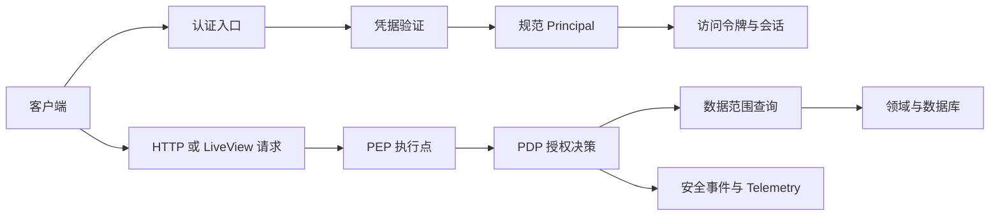

# Keystone Native 与 Keystone Phoenix 鉴权授权统一架构

更新日期：2026-11-13。本文是两个项目的共同架构基线。实现语言、数据库和 Web 框架可以不同，但外部行为、数据约定和安全边界必须一致。

## 术语和命名规则

| 术语 | English | 职责 | 不负责的内容 |
| --- | --- | --- | --- |
| 主体 | Subject | 表示人类用户或服务主体，使用稳定 ID。 | 不表示一次登录，不保存明文凭据。 |
| 凭据 | Credential | 表示密码、刷新令牌、API Key 或外部身份凭据。 | 不直接决定业务权限。 |
| 规范主体 | Principal | 表示当前请求已经验证的主体、凭据类型、会话、权限和认证强度。 | 不负责查询业务记录。 |
| 会话 | Session | 保存一次登录的状态、客户端、令牌族和撤销状态。 | 不替代令牌签名。 |
| 权限 | Permission | 表示稳定的 `resource:action` 动作标识。 | 不表示菜单路径或角色名称。 |
| 数据范围 | Data scope | 限制主体可以访问的租户、部门、所有者或成员关系。 | 不授予动作权限。 |
| 授权决策点 | Policy Decision Point（PDP） | 根据 Principal、Permission、资源和请求上下文返回允许或拒绝。 | 不渲染页面，不直接处理 HTTP。 |
| 授权执行点 | Policy Enforcement Point（PEP） | 在 HTTP、LiveView 或领域命令入口执行 PDP 决策。 | 不复制另一套权限规则。 |
| 安全事件 | Security event | 记录登录、令牌、API Key、MFA 和授权结果。 | 不保存密码、令牌或完整 API Key。 |

新权限统一使用两段格式：`resource:action`，例如 `user:read`、`user:write`、`api-key:create`、`session:revoke`。Phoenix 现有三段权限，例如 `system:user:edit`，只作为兼容输入，由集中映射转换到两段权限。新代码不得新增三段权限。

## 主键和标识符

用户、角色、部门、菜单、权限、会话、令牌族、API Key、MFA 请求和审计记录的主键统一使用规范小写连字符 UUID 字符串。新建业务实体默认使用 UUIDv7，以便保留创建时间排序特征；权限目录、固定种子和跨项目需要稳定复现的标识使用 UUIDv5，并固定命名空间和名称规则。UUIDv5 不用于随机业务实体。

两个项目都禁止把 UUID 转回整数、使用自增整数或在接口中同时暴露整数和 UUID。Native 的 MySQL 使用 `BINARY(16)` 保存 UUID 原始 16 字节：写入使用 `UUID_TO_BIN(?, 0)`，读取文本结果使用 `BIN_TO_UUID(id, 0)`；按 ID 过滤时在参数侧使用 `UUID_TO_BIN(:uuid, 0)`，不在列上调用 `BIN_TO_UUID`，以保持索引可用。`0` 保持 UUIDv7 的时间字段顺序，不使用 UUIDv1 专用的字节交换。应用层和 HTTP 接口只接受或返回 36 字符的规范 UUID 字符串，ORM 转换器负责字符串与 `BINARY(16)` 的边界转换。Phoenix 的 PostgreSQL 使用原生 `uuid` 类型。迁移阶段允许破坏性替换旧整数主键，外键、索引、缓存键、日志字段、令牌 Claim 和测试数据必须同批更新。

UUID 生成规则必须集中在基础模块。UUIDv7 生成失败时请求失败，不使用时间戳拼接、随机字符串或整数回退。UUIDv5 的命名空间、名称、版本和大小写规则必须写入迁移说明和跨项目测试向量。

## 目标架构



受保护请求必须按相同顺序处理：验证凭据、建立 Principal、检查 Permission、检查 Data scope、执行领域动作、写入安全事件。菜单、按钮和前端状态只影响展示，不承担安全边界。

## Principal 和令牌约定

两个项目的 Principal 至少包含：

```text
subject_id / subject_type
credential_type / credential_id
session_id / client_id
tenant_id / role_ids
permissions / approved_scopes
data_scope / permission_version
authentication_level
```

`is_admin` 只作为迁移期兼容字段。拥有角色的主体必须从规范角色权限关系读取权限。无角色的历史管理员账号可以暂时使用兼容回退，最终删除字段旁路。

访问令牌必须校验 `iss`、`aud`、`sub`、`jti`、`sid`、`iat`、`exp`、令牌类型、签名算法和 `permission_version`。令牌头部使用 `kid`。访问令牌建议五分钟有效，刷新令牌建议十四天绝对期限和二十四小时非活动期限。刷新令牌每次使用都轮换；旧令牌重用时撤销整个令牌族。签发失败时撤销刚创建或刚轮换的会话。

## 权限、范围和审计

权限目录是唯一权限来源。角色绑定权限 ID，不绑定菜单名称。菜单可以引用权限用于展示，但菜单变化不能改变角色权限。

统一范围策略为 `ALL`、`TENANT`、`SELF`、`DEPARTMENT`、`DEPARTMENT_AND_CHILDREN`、`CUSTOM`、`OWNER` 和 `MEMBER`。列表、详情、更新、删除、导出、批量操作和异步任务都必须使用同一范围策略。批量操作逐个检查目标；任一目标越界时整个事务回滚。

PDP 固定提供：

```text
authorize(principal, permission, resource, context)
allowed(principal, permission, context)
scope_allowed(principal, scope, resource, context)
```

缺少权限映射、主体无效、资源上下文不完整或策略存储不可用时默认拒绝。策略缓存键至少包含版本、租户、主体角色和权限。权限目录、角色权限、角色状态、用户角色或范围变化时增加版本并清理缓存。

安全事件至少记录主体、会话、凭据类型和 ID、权限、资源、范围、决策、原因、请求 ID 和时间。禁止保存密码、访问令牌、刷新令牌、验证码、完整 API Key 和敏感请求体。授权 Telemetry 至少区分允许、权限拒绝、范围拒绝和策略不可用。

## 凭据能力

- 密码会话：只用于人类用户登录，创建独立会话和刷新令牌族。
- API Key：使用 `ks_live_<prefix>_<secret>` 格式。数据库只保存哈希、前缀、主体、范围、过期和撤销状态。明文只返回一次。有效范围是请求范围、签发者可授予范围和主体当前权限的交集。API Key 不能访问密码修改、MFA 或 API Key 管理路径。
- MFA：第一版使用 TOTP、一次性恢复码和短期认证请求。敏感写操作需要 AAL2 step-up。并发消费必须只有一次成功。
- 外部身份：后续使用 OIDC Authorization Code + PKCE，并校验 `state`、`nonce`、issuer、audience 和时间窗口。

## Phoenix 适配边界

Phoenix 使用 Controller、Plug、LiveView 事件和领域命令作为 PEP；`KeystonePhoenix.Authz`、`PolicyStore` 和 `Principal` 作为 PDP 适配层。Ecto、PostgreSQL 和 Ecto migration 负责持久化。

Legacy 权限必须通过显式映射转换，例如：

| Legacy 权限 | 规范权限 |
| --- | --- |
| `system:user:list`、`system:user:query` | `user:read` |
| `system:user:add`、`system:user:edit`、`system:user:remove` | `user:write` |
| `system:user:export`、`system:user:import` | `user:export`、`user:import` |
| `system:role:permission` | `role:manage` |
| `system:job:run`、`system:job:changeStatus` | `job:run` |
| `system:file:upload`、`system:file:download` | `file:write`、`file:read` |
| `monitor:online:forceLogout` | `session:revoke` |

Phoenix 保留现有 `{code,msg,data}` 兼容响应；新增现代接口统一使用 `{success,data,message}`。同一业务错误必须在两个响应层映射到相同的错误分类。

## Native 适配边界

Native 使用 Quarkus REST、`HttpAuthenticationMechanism`、`PermissionInterceptor`、`AuthorizationService` 和 `DataScopeService` 作为 PEP/PDP 适配层；Hibernate ORM with Panache、MySQL 和 Flyway 负责持久化。`AuthResource`、`ApiKeyResource`、`MfaService` 和 `JwkSetService` 必须共享同一 Principal 和权限目录。

Phoenix 的 LiveView 事件总线属于管理界面能力。Native 当前只提供后端 API；若后续需要管理界面，单独定义客户端和事件协议，不把 LiveView 行为强行复制到 Quarkus 服务。

## 设计决策

1. 两项目使用同一权限语义和错误分类，允许响应字段名在兼容层不同。
2. 两项目使用同一 Principal 字段集合，允许 Java record 和 Elixir struct 不同。
3. 两项目使用各自数据库事务和锁机制，但必须证明相同状态转换和并发结果。
4. 新功能先写公共接口约定和跨项目测试向量，再写语言适配代码。
5. 迁移期允许破坏性数据库更新。已执行迁移追加新版本，禁止修改已执行迁移。
